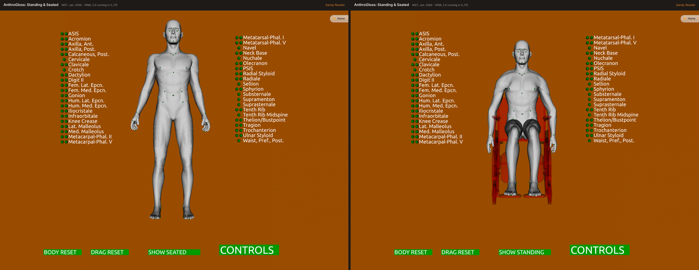

# AnthroGloss

### [▶ RUN ME](https://claude.ai/artifact/RLDRgZ2TMoNxLVKZEtrGgr)

AnthroGloss is an interactive glossary of human-body anthropometric landmarks, created by
Jerry Candela and [Sandy Ressler](https://www.linkedin.com/in/sressler/) at the National Institute
of Standards and Technology (NIST) in January 2000 as VRML 2.0 worlds. This repository brings
the original *Standing Man* and *Man in Wheelchair* worlds back to life in a modern web browser
using the [X_ITE](https://create3000.github.io/x_ite/) X3D/VRML browser, combined into a single world.

## Using it

- **Landmark spheres** (the two columns): click a sphere to fly to that landmark's viewpoint,
  highlight it on the body, and show its full name.
- **BODY RESET** flies back to the home view of the body.
- **DRAG RESET** returns the dragged menus (landmark columns, control panel, name banner) to their home positions.
- **SHOW SEATED / SHOW STANDING** switches between the two bodies.
- **CONTROLS** opens the original panel of body planes, arm-reach indicators, sight cone
  (and, for the seated man, the wheelchair).
- Drag to rotate, scroll to zoom; right-click for the X_ITE menu.

## Run locally

Open `anthrogloss_standalone.html` in a browser (it embeds the VRML as plain text;
it loads X_ITE from the jsDelivr CDN, so it needs an internet connection).
`index.html` is the same page with the world embedded gzip-compressed.

## Repository contents

| Path | What it is |
|---|---|
| `index.html` | Web page (X_ITE + embedded, compressed world) |
| `anthrogloss_standalone.html` | Same page with the VRML embedded as editable text |
| `worlds/anthrogloss_combined.wrl` | Combined VRML world: both bodies in one `Switch` |
| `worlds/mangloss35_xite.wrl`, `worlds/manwc_xite.wrl` | Each body on its own, with the X_ITE fixes |
| `original/` | The original NIST 2000 worlds (gzipped VRML) |
| `tools/` | Python scripts that produced the converted worlds, and the page template |

## Changes made for X_ITE

- **Landmark selection** — the original scripts asked global "clear all" scripts to reset every
  landmark in the same event that highlighted one; X_ITE runs the reset last, so nothing stayed
  highlighted. A single `LANDMARKS` script now clears and highlights in one step.
- **Viewpoint jumps** — each text sphere sat inside an `Anchor url "#VPBnn"` together with its own
  `TouchSensor`; X_ITE gives the click to the inner sensor, so the anchor never fired. The anchors
  are now plain groups and the sphere's script binds the viewpoint directly.
- **Animated transitions** — the page makes every viewpoint change fly with ease-in/ease-out (1.5 s).
- **Layout** — landmark columns scaled to 50 %, new default (home) positions for the columns and
  the body, `DRAG RESET` returns to those positions, and a new **BODY RESET** button.
- **Combined world** — both bodies in one `Switch` (standing man by default); the wheelchair world's
  DEF names carry a `B_` prefix. A shared Background and NavigationInfo sit outside the Switch.

`tools/fixwrl.py` applies the per-world changes, `tools/merge.py` builds the combined world.

## Credits

World design and anthropometric content: Jerry Candela and Sandy Ressler, NIST, 2000.
Humanoid model and posing: Poser 4. Wheelchair model: 3Name3D clip art.
Anthropometric sources are listed in each world's `WorldInfo`.
